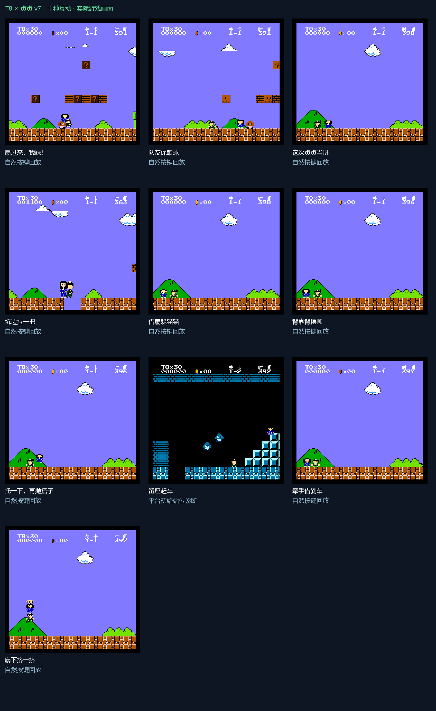

# T8 × 贞贞 v7

T8 与贞贞的 FC 合作改版，初始 **30 条命**，支持召唤搭档、一起变大变小、踩怪、撞砖、借头二段跳，以及十种新互动。



## 下载直接玩

打开 [v7 Release](https://github.com/T8mars/T8_Zhenzhen/releases/tag/v7.0.0)，下载 **T8-Zhenzhen-v7-Windows.zip**。

1. 把 ZIP 完整解压到一个文件夹。
2. 双击 `开始游戏-v7.cmd` 或 `Play-v7.cmd`。
3. 按 **Enter** 开始，方向键移动，**F 跳跃 / D 加速与火球 / S 召唤贞贞**。

便携包包含游戏、已配置双控制器的 FCEUX、依赖、操作说明及模拟器对应源码。无需安装 Node、Python，也不需要另找游戏文件。适用于 Windows 64 位。

更多操作见 [玩法手册](docs/controls.md)，重点新增按键为 **Q 指挥/托举、W 摆帅/缓降、E 互动、R 挥扇**。按方向再新按技能键；部分技能需要保持 Q 或 W。

## 源码

| 目录 | 内容 |
| --- | --- |
| `game/tools/v7/` | 原创6502游戏逻辑、角色图块生成与构建脚本 |
| `game/output/` | v7 BPS补丁、构建清单和构建所需v3补丁 |
| `game/vendor/jsnes/` | 固定JSNES2.1.0的CPU指令元数据与Apache2许可 |
| `web/` | React/Vite网页源码、音频、按键、触控、存档与迁移测试 |
| `packaging/` | 便携包构建、模拟器配置及实机启动验证 |
| `verification/` | 验证摘要；历史验证与本次发布验证分开记录 |

Git源码不包含完整游戏ROM、模拟器程序、依赖缓存和生成目录。网页的原始ROM输入需要自行放到 `web/src/超级玛丽.nes`；便携版在Release提供。

### 从精确基底重建游戏

Python3.10+，只用标准库：

```powershell
cd game
python tools/v7/rebuild_from_original.py "你的超级玛丽.nes路径"
```

必须使用选定的中文改版基底，SHA-256：
`4473b008df230c7dc071a977c26b0b53426aeb9fff2042935f10e8c4c7457225`

生成 `game/output/t8-zhenzhen-v7-p17.nes`，不会覆盖基底。目标SHA-256：
`c3baec6b9c555cd1b1170e38d9d88f64805c08629144c01f0e8dcf9c5916e315`

### 网页开发

使用 Node22.19+（或支持当前Vite的更新版本）和pnpm。先把精确基底复制到 `web/src/超级玛丽.nes`，再运行：

```powershell
cd web
pnpm install --frozen-lockfile --ignore-scripts
pnpm run build
pnpm run lint
pnpm test
pnpm run dev
```

打开 `http://localhost:8000`。网页在首次CPU帧前清零2KiB工作RAM，避免进入错误的0-1关卡；读档恢复完整机器状态。v7使用独立存档键，按ROM身份迁移旧包误存的v7记录，保留真正v6数据。

VibeX原项目升级见 [交接说明](docs/vibex.md)。原平台配置保持；公开站点需要在VibeX预览验收后重新发布。

## 验证与许可

本次源码重建与正式ROM字节一致；网页构建、lint及13项测试通过，实际发布的官方FCEUX完成冷启动1-1/30命、召唤、短指挥及返回T8验证。[验证范围与已知限制](docs/validation.md)和[第三方许可](docs/third-party.md)随包提供。
